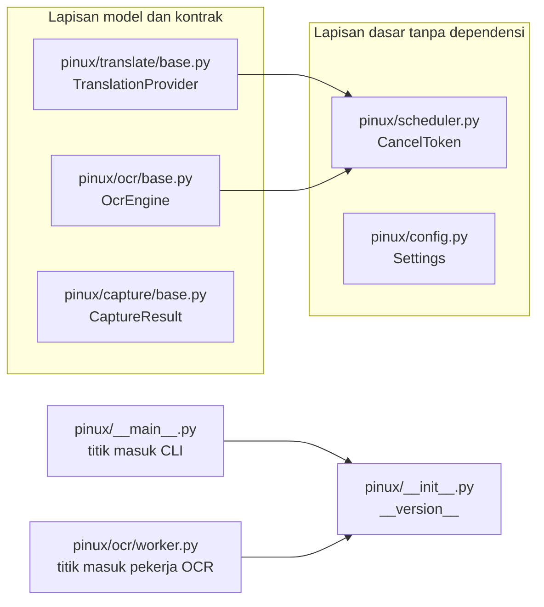
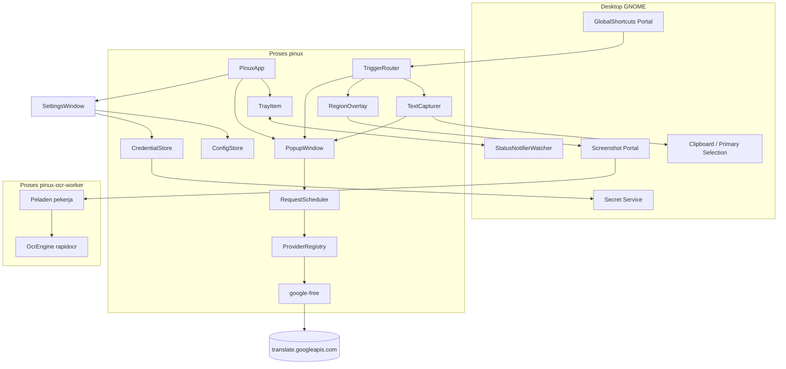
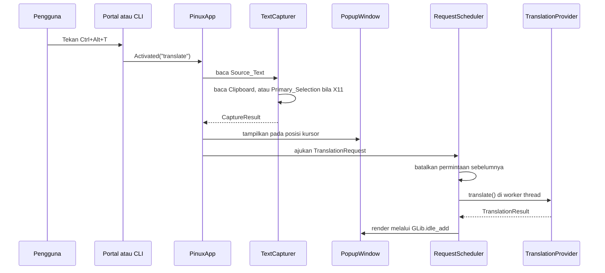

# Arsitektur Pinux

## Gambaran Umum

Pinux adalah aplikasi penerjemah desktop untuk Linux yang mengadaptasi alur kerja Bob pada macOS. Pengguna memicu terjemahan dari aplikasi mana pun melalui pintasan keyboard global; Pinux lalu mengambil teks yang sedang disalin, menerjemahkannya, dan menampilkan hasilnya pada jendela popup ringan di dekat kursor. Selain teks, Pinux dirancang menerjemahkan teks di dalam gambar melalui OCR atas tangkapan layar, sehingga teks pada video, gambar, atau aplikasi yang melarang penyalinan tetap dapat dipahami.

Pinux menyasar pengguna desktop Linux, khususnya sesi GNOME pada Wayland maupun X11. Aplikasi berjalan sebagai layanan latar belakang dengan ikon tray, sehingga pintasan keyboard selalu siap tanpa jendela utama yang menetap. Basis kode memakai Python 3.11+ di atas GTK 4 dan libadwaita melalui PyGObject, dengan pilihan ini diambil karena seluruh dependensinya tersedia pada distribusi target tanpa pemasangan paket sistem tambahan.

Arsitekturnya memisahkan proses utama yang menjalankan GTK main loop dari proses pekerja OCR yang dijalankan sesuai kebutuhan. Pemisahan ini menjaga proses utama tetap ringan dan membebaskan dependensi inti dari ONNX Runtime, sehingga Pinux tetap berjalan ketika paket OCR tidak terpasang. Penerjemahan dan OCR dijalankan di luar thread utama, dengan hasil dikembalikan melalui `GLib.idle_add`.

Integrasi desktop dilakukan melalui portal XDG D-Bus, bukan melalui pemanggilan biner eksternal: portal `GlobalShortcuts` untuk pintasan keyboard, portal `Screenshot` untuk tangkapan layar, dan `org.freedesktop.secrets` melalui libsecret untuk penyimpanan API key. Pendekatan ini menghindari ketergantungan pada perkakas seperti `xdotool`, `gnome-screenshot`, atau `wl-clipboard`.

Saat ini Pinux berada pada tahap awal pengembangan. Lapisan model data, antarmuka, dan konfigurasi sudah tersedia beserta pengujiannya; lapisan portal, antarmuka pengguna, dan integrasi masih dalam pengerjaan. Lihat bagian Status Implementasi di bawah.

## Status Implementasi

Dokumen ini membedakan dengan tegas apa yang sudah ada di repositori dan apa yang masih berupa rencana pada `design.md`.

| Bagian | Status | Lokasi |
|---|---|---|
| Struktur paket dan metadata | Sudah ada | `pyproject.toml`, `pinux/` |
| Model data dan Protocol inti | Sudah ada | `pinux/translate/base.py`, `pinux/ocr/base.py`, `pinux/capture/base.py` |
| Token pembatalan | Sudah ada | `pinux/scheduler.py` |
| Model pengaturan | Sudah ada | `pinux/config.py` |
| Uji unit lapisan model | Sudah ada, 25 uji lulus | `tests/test_models.py` |
| Pemuatan dan penulisan berkas TOML | Sudah ada, task 4 | `pinux/configstore.py`, `tests/test_configstore.py` |
| Penyimpanan kredensial | Sudah ada, task 5 | `pinux/credentials.py`, `tests/test_credentials.py` |
| Provider `google-free` | Sudah ada, task 6 | `pinux/translate/google_free.py`, `tests/test_google_free.py` |
| Registri provider | Sudah ada, task 7 | `pinux/translate/registry.py`, `tests/test_registry.py`, `examples/deepl_provider.py` |
| Penjadwal permintaan | Sudah ada, task 8 | `pinux/scheduler.py`, `tests/test_scheduler.py` |
| Penangkapan teks dari Clipboard | Sudah ada, task 10 | `pinux/capture/capturer.py`, `tests/test_capture.py` |
| Klien portal GlobalShortcuts | Sudah ada, task 11 | `pinux/portal/shortcuts.py`, `tests/test_portals.py` |
| Klien portal Screenshot | Sudah ada, task 12 | `pinux/portal/screenshot.py`, `tests/test_portals.py` |
| Pekerja dan klien OCR | Sudah ada, task 13 | `pinux/ocr/client.py`, `pinux/ocr/worker.py`, `tests/test_ocr.py` |
| Popup, overlay area, tray, pengaturan | Sudah ada, task 15-18 | `pinux/ui/`, `pinux/tray.py`, `tests/test_popup.py`, `tests/test_region.py`, `tests/test_tray.py`, `tests/test_settings_ui.py` |
| Perakitan aplikasi dan CLI | Sudah ada, task 19 | `pinux/app.py`, `pinux/__main__.py`, `tests/test_app.py` |
| Integrasi desktop | Sudah ada, task 20 | `data/pinux.desktop`, `data/pinux-autostart.desktop`, `data/icons/pinux.svg` |

## Tumpukan Teknologi

**Bahasa dan runtime**

- Python 3.11 atau lebih baru; repositori pengembangan berjalan pada Python 3.14.4
- Runtime sesi desktop GNOME Shell 50.1 pada Wayland (target uji utama), dengan X11 sebagai target pendukung

**Kerangka kerja**

- GTK 4.10+ dan libadwaita 1.4+ melalui PyGObject 3.56
- `GApplication` dari GLib/Gio 2.88 untuk siklus hidup, instans tunggal, dan aksi baris perintah
- pytest 9 sebagai kerangka pengujian, hypothesis 6 untuk uji properti

**Integrasi sistem**

- `dbus-python` 1.3 dan `pydbus` untuk portal XDG dan Secret Service
- libsecret melalui typelib `Secret-1` untuk penyimpanan Credential
- Pillow untuk pemotongan citra hasil tangkapan layar

**Dependensi opsional**

- `rapidocr-onnxruntime` 1.4 dan `onnxruntime` 1.17+ sebagai mesin OCR luring, dipasang melalui extra `ocr`

**Layanan eksternal**

- `translate.googleapis.com` sebagai endpoint Free_Provider pada rilis pertama

## Struktur Proyek

```
MonkeyCode/
├── pinux/                    # Paket aplikasi
│   ├── __init__.py           # Versi paket
│   ├── __main__.py           # Titik masuk perintah `pinux`
│   ├── config.py             # Dataclass pengaturan
│   ├── scheduler.py          # CancelToken
│   ├── translate/            # Mesin penerjemahan
│   │   └── base.py           # Model data dan Protocol TranslationProvider
│   ├── ocr/                  # Mesin OCR
│   │   ├── base.py           # Model data dan Protocol OcrEngine
│   │   └── worker.py         # Titik masuk proses pekerja OCR
│   ├── capture/              # Penangkapan teks
│   │   └── base.py           # CaptureResult
│   ├── portal/               # Klien portal D-Bus
│   └── ui/                   # Antarmuka GTK4
├── tests/                    # Pengujian
│   ├── conftest.py           # Fixture bersama dan clipboard palsu
│   └── test_models.py        # Uji unit lapisan model
├── .monkeycode/
│   ├── docs/                 # Dokumentasi ini
│   └── specs/linux-translator/
│       ├── requirements.md   # Kebutuhan fungsional, format EARS
│       ├── design.md         # Desain teknis
│       └── tasklist.md       # Rencana implementasi
├── pyproject.toml            # Metadata, dependensi, konfigurasi pytest
└── README.md                 # Pengantar singkat
```

**Titik masuk**

- `pinux/__main__.py:main` - perintah `pinux`; rangkaian aksi diimplementasikan pada task 19
- `pinux/ocr/worker.py:main` - perintah `pinux-ocr-worker`; peladen pekerja OCR diimplementasikan pada task 13

## Subsistem

### Model domain penerjemahan

**Tujuan**: menetapkan bentuk data dan kontrak yang harus dipenuhi setiap mesin penerjemahan
**Lokasi**: `pinux/translate/`
**Berkas kunci**: `base.py`
**Isi**: `Language`, `TranslationRequest`, `TranslationResult`, `TranslationError`, dan Protocol `TranslationProvider`
**Dependensi**: `pinux.scheduler`
**Diandalkan oleh**: registri provider, penjadwal permintaan, popup, jendela pengaturan

### Model domain OCR

**Tujuan**: menetapkan bentuk data dan kontrak mesin OCR, terpisah dari dependensi beratnya
**Lokasi**: `pinux/ocr/`
**Berkas kunci**: `base.py`, `worker.py`
**Isi**: `OcrLine`, `OcrResult`, Protocol `OcrEngine`, dan titik masuk proses pekerja
**Dependensi**: `pinux.scheduler`
**Diandalkan oleh**: overlay area, klien pekerja OCR, jendela pengaturan

### Model penangkapan teks

**Tujuan**: mewakili hasil penangkapan Source_Text beserta asal dan status pemotongannya
**Lokasi**: `pinux/capture/`
**Berkas kunci**: `base.py`
**Isi**: `CaptureOrigin` dan `CaptureResult`
**Dependensi**: tidak ada
**Diandalkan oleh**: TextCapturer, popup, alur OCR

### Pengaturan

**Tujuan**: mewakili pengaturan Pinux beserta nilai bawaannya sebagai satu objek
**Lokasi**: `pinux/config.py`
**Isi**: `Settings`, `PopupSettings`, `OcrSettings`, `ProviderEntry`, dan `default_shortcuts`
**Dependensi**: tidak ada
**Diandalkan oleh**: ConfigStore, popup, jendela pengaturan, registri provider

### Pembatalan permintaan

**Tujuan**: menandai permintaan yang sudah tidak diperlukan, sehingga pekerjaan jaringan atau pengenalan dapat dihentikan lebih awal
**Lokasi**: `pinux/scheduler.py`
**Isi**: `CancelToken`
**Dependensi**: tidak ada
**Diandalkan oleh**: Translation_Provider, OcrEngine, penjadwal permintaan

## Diagram

### Grafik dependensi modul yang sudah ada



Modul domain hanya bergantung pada `pinux.scheduler`, dan tidak satu pun modul memuat dependensi GTK maupun ONNX Runtime. Sifat ini menjaga Properti 7 pada design.md dan diuji melalui `tests/test_models.py`.

### Arsitektur yang direncanakan

Diagram berikut menggambarkan arsitektur target sesuai `design.md`. Sebagian besar komponen di dalamnya belum diimplementasikan.



### Alur pemicu terjemahan yang direncanakan



## Keputusan Desain

| Keputusan | Pilihan | Alasan |
|---|---|---|
| Toolkit antarmuka | GTK 4 dan libadwaita melalui PyGObject | Seluruh dependensi tersedia pada distribusi target tanpa `sudo`, dan integrasinya paling mulus dengan GNOME |
| Bahasa | Python 3.11+ | Menghindari kebutuhan memasang rantai perkakas tambahan seperti Rust, sekaligus memanfaatkan PyGObject yang sudah ada |
| Model proses | Satu proses GTK ditambah satu proses pekerja OCR sesuai kebutuhan | Menjaga proses utama ringan dan memenuhi R7.5 |
| Instans tunggal | `GApplication` dengan D-Bus activation | Pengalihan instans dan penanganan aksi baris perintah tersedia tanpa kode tambahan |
| Pemicu global | Portal `GlobalShortcuts` dengan fallback perintah CLI | Portal tersedia pada GNOME Shell 50, sedangkan fallback menjamin Pinux tetap dapat dipakai pada desktop tanpa portal |
| Ikon tray | Implementasi `StatusNotifierItem` murni Python melalui D-Bus | Binding `AyatanaAppIndicator3` tidak tersedia pada sistem target dan pemasangannya memerlukan `sudo` |
| Penyimpanan kredensial | libsecret melalui typelib `Secret-1` | Nama D-Bus `org.freedesktop.secrets` aktif dan `Secret-1.typelib` tersedia |
| OCR luring | RapidOCR berbasis ONNX Runtime pada proses terpisah | Berjalan tanpa jaringan dan tanpa paket sistem; roda `cp314` tersedia untuk Python 3.14 |
| Tangkapan area | Overlay sendiri, tangkap layar penuh melalui portal, lalu potong dengan Pillow | Portal Screenshot tidak menyediakan parameter area persegi |
| Kontrak provider | `Protocol`, bukan kelas dasar | Provider pihak ketiga tidak perlu mewarisi kode Pinux, cukup memenuhi bentuk yang diharapkan |
| Validasi galat | `TranslationError` memvalidasi `kind` saat pembuatan objek | Menjaga pemetaan galat provider tetap konsisten dan dapat diuji |

## Risiko Teknis Terbuka

Risiko berikut belum terselesaikan dan dapat mengubah desain. Rinciannya ada pada bagian Risks and Spikes di `design.md`.

1. Tangkapan area pada Wayland: perlu dipastikan portal Screenshot mengembalikan citra tanpa memunculkan antarmuka pemilihan.
2. Konversi koordinat pada penskalaan fraksional dan susunan dua monitor.
3. Pembacaan Clipboard ketika jendela Pinux tidak memegang fokus.
4. Pengikatan ulang pintasan portal pada setiap startup.
5. Pemasangan nyata tumpukan ONNX pada Python 3.14.
6. Tampilnya `StatusNotifierItem` pada GNOME Shell 50 melalui ekstensi `appindicatorsupport`.

## Rujukan

- [Kebutuhan fungsional](../specs/linux-translator/requirements.md)
- [Desain teknis](../specs/linux-translator/design.md)
- [Rencana implementasi](../specs/linux-translator/tasklist.md)
