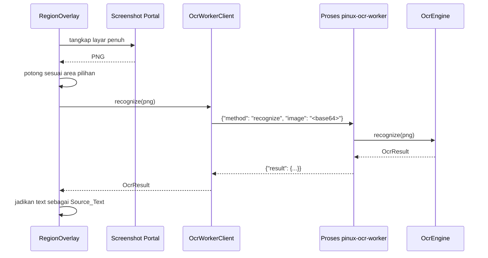

# OcrEngine

Kontrak mesin pengenalan teks pada citra di Pinux. Konsep ini ada agar teks di dalam gambar, video, atau aplikasi yang melarang penyalinan tetap dapat diterjemahkan, dengan dependensi berat yang terisolasi dari proses utama.

## Apa itu OcrEngine?

OcrEngine adalah komponen yang menerima citra PNG lalu mengembalikan teks beserta posisi setiap barisnya. Pada rilis pertama Pinux memakai RapidOCR yang berbasis ONNX Runtime dan berjalan sepenuhnya luring.

**Ciri utama:**

- Didefinisikan sebagai `Protocol`, sehingga mesin OCR lain dapat ditambahkan.
- Berjalan pada proses terpisah, bukan di dalam proses utama Pinux.
- Hasilnya menjadi Source_Text, sehingga alur terjemahan setelahnya sama dengan alur teks biasa.

## Mengapa Proses Terpisah

ONNX Runtime berukuran besar, memerlukan waktu muat yang cukup lama, dan tidak diperlukan ketika pengguna hanya menerjemahkan teks. Pinux karena itu menjalankan OCR pada proses `pinux-ocr-worker` yang dijalankan secara lazy.

| Aspek | Proses utama | Proses pekerja OCR |
|---|---|---|
| Mengimpor `onnxruntime` dan `rapidocr` | Tidak | Ya |
| Dihentikan setelah 5 menit tanpa aktivitas | Tidak berlaku | Ya |
| Memblokir antarmuka saat bekerja | Tidak | Tidak, karena terpisah |
| Tetap berjalan bila paket OCR tidak terpasang | Ya | Tidak dijalankan |

Pemisahan ini menjaga Properti 7 pada `design.md`: proses utama tetap berjalan ketika paket OCR tidak terpasang, dengan aksi OCR dalam keadaan tidak aktif.

## Lokasi Kode

| Aspek | Lokasi |
|---|---|
| Model dan Protocol | `pinux/ocr/base.py` |
| Protokol JSON-RPC | `pinux/ocr/protocol.py`, direncanakan pada task 13 |
| Peladen pekerja | `pinux/ocr/worker.py`, direncanakan pada task 13 |
| Implementasi RapidOCR | `pinux/ocr/rapidocr_engine.py`, direncanakan pada task 13 |
| Klien pekerja | `pinux/ocr/client.py`, direncanakan pada task 13 |
| Pengujian | `tests/test_ocr_protocol.py`, direncanakan pada task 13.1 |

## Bentuk Kontrak

```python
@runtime_checkable
class OcrEngine(Protocol):
    id: str

    def is_available(self) -> bool: ...
    def ensure_model(self, on_progress: Callable[[float], None]) -> None: ...
    def recognize(self, image_png: bytes, cancel: CancelToken) -> OcrResult: ...
```

### Anggota penting

| Anggota | Tipe | Keterangan |
|---|---|---|
| `id` | `str` | Pengenal unik, misalnya `"rapidocr"` |
| `is_available` | `bool` | Menentukan apakah mesin beserta dependensinya tersedia |
| `ensure_model` | `None` | Memuat atau mengunduh model, melaporkan kemajuan `0.0` sampai `1.0` |
| `recognize` | `OcrResult` | Mengenali teks pada citra PNG |

### Bentuk hasil

```python
@dataclass(frozen=True)
class OcrLine:
    text: str
    confidence: float
    box: tuple[float, float, float, float]   # (left, top, right, bottom) dalam piksel

@dataclass(frozen=True)
class OcrResult:
    text: str
    lines: Sequence[OcrLine] = ()
```

## Diagram Alur



## Invarian

1. **Ketergantungan terisolasi.** Proses utama Pinux tidak pernah mengimpor `onnxruntime` atau `rapidocr`.
2. **Kemajuan monoton.** Nilai yang diteruskan `on_progress` tidak pernah menurun.
3. **Ketersediaan jujur.** `is_available` bernilai `False` ketika dependensi atau model tidak ada, bukan memunculkan pengecualian.
4. **Hasil konsisten.** `OcrResult.text` memuat seluruh `OcrLine.text` pada `lines`.
5. **Penghormatan pembatalan.** `recognize` berhenti setelah `cancel.cancelled` bernilai benar.

## Persyaratan Kinerja

Pinux menargetkan pengenalan area 800x600 piksel dalam waktu kurang dari 3 detik pada prosesor 4 inti (R7.2).

## Hubungan dengan Konsep Lain

| Konsep | Hubungan |
|---|---|
| [Source_Text](./Source_Text.md) | Hasil OCR berperan sebagai Source_Text dengan `origin` bernilai `"ocr"` |
| [CancelToken](./CancelToken.md) | Diterima `recognize` untuk menghentikan pengenalan |
| [TranslationProvider](./TranslationProvider.md) | Sepadan pada sisi penerjemahan |
