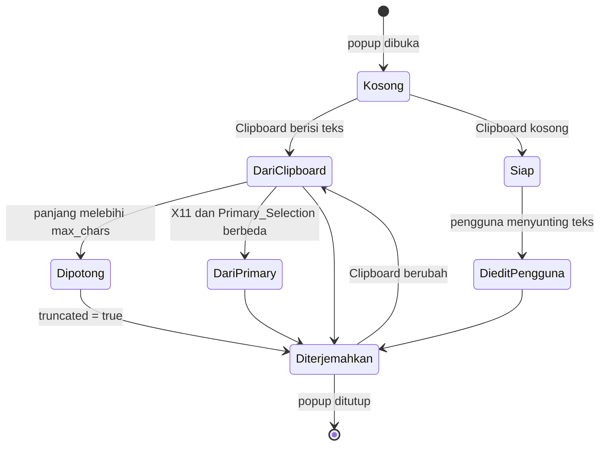

# Source_Text dan CaptureResult

Source_Text adalah teks yang menjadi masukan proses penerjemahan, dan `CaptureResult` adalah cara Pinux mewakilinya beserta asal dan status pemotongannya.

## Apa itu Source_Text?

Source_Text adalah teks yang sedang diterjemahkan. Nilainya dapat berasal dari tiga sumber: Clipboard, `Primary_Selection` pada sesi X11, atau hasil pengenalan OCR. Konsep ini ada agar seluruh jalur masukan memiliki bentuk yang sama, sehingga alur terjemahan setelah penangkapan tidak perlu membedakan asal teks.

**Ciri utama:**

- Panjangnya selalu dibatasi oleh `Settings.max_chars`, dengan nilai bawaan 5000 karakter.
- Asalnya selalu diketahui, sehingga antarmuka dapat menandai teks hasil OCR secara berbeda.
- Pada sesi Wayland, Pinux hanya membaca Clipboard saat popup dibuka atau saat ada pemicu, bukan terus-menerus.

## Lokasi Kode

| Aspek | Lokasi |
|---|---|
| Model | `pinux/capture/base.py` |
| Ekspor ulang paket | `pinux/capture/__init__.py` |
| TextCapturer | `pinux/capture/capturer.py`, direncanakan pada task 10 |
| Pengujian | `tests/test_capture.py`, direncanakan pada task 10.1 |

## Struktur

```python
CaptureOrigin = Literal["clipboard", "primary", "ocr"]

@dataclass(frozen=True)
class CaptureResult:
    text: str
    truncated: bool
    origin: CaptureOrigin
```

### Bidang penting

| Bidang | Tipe | Keterangan |
|---|---|---|
| `text` | `str` | Source_Text, batas panjangnya `Settings.max_chars` |
| `truncated` | `bool` | `True` jika dan hanya jika teks dipotong |
| `origin` | `CaptureOrigin` | Asal teks: `"clipboard"`, `"primary"`, atau `"ocr"` |

## Perilaku menurut Sesi Desktop

| Sesi | Sumber teks | Pemicu pembaruan |
|---|---|---|
| Wayland | `Gdk.Clipboard` | Sinyal `changed` pada `GdkClipboard` saat popup terbuka |
| X11 | `Gdk.Clipboard` dan `Gdk.Display.get_primary_clipboard()` | Sinyal `changed` pada kedua objek clipboard |

Pada sesi X11, isi `Primary_Selection` dipakai ketika berbeda dari isi Clipboard, dengan `origin` bernilai `"primary"`. Pada sesi Wayland, nilai `"primary"` tidak pernah muncul.

## Diagram Alur



## Invarian

1. **Batas panjang.** `len(text) <= max_chars` selalu berlaku.
2. **Penandaan jujur.** `truncated` bernilai `True` jika dan hanya jika pemotongan terjadi.
3. **Asal tidak pernah kosong.** `origin` selalu bernilai salah satu dari tiga nilai yang sah.
4. **Ketiadaan pesan galat untuk Clipboard kosong.** Clipboard kosong menghasilkan `text` kosong, bukan kegagalan.

## Hubungan dengan Konsep Lain

| Konsep | Hubungan |
|---|---|
| [TranslationProvider](./TranslationProvider.md) | Menerima Source_Text sebagai `TranslationRequest.text` |
| [OcrEngine](./OcrEngine.md) | Hasil pengenalan OCR menjadi Source_Text dengan `origin` bernilai `"ocr"` |
| [CancelToken](./CancelToken.md) | Permintaan atas Source_Text lama dibatalkan ketika teks berubah |
