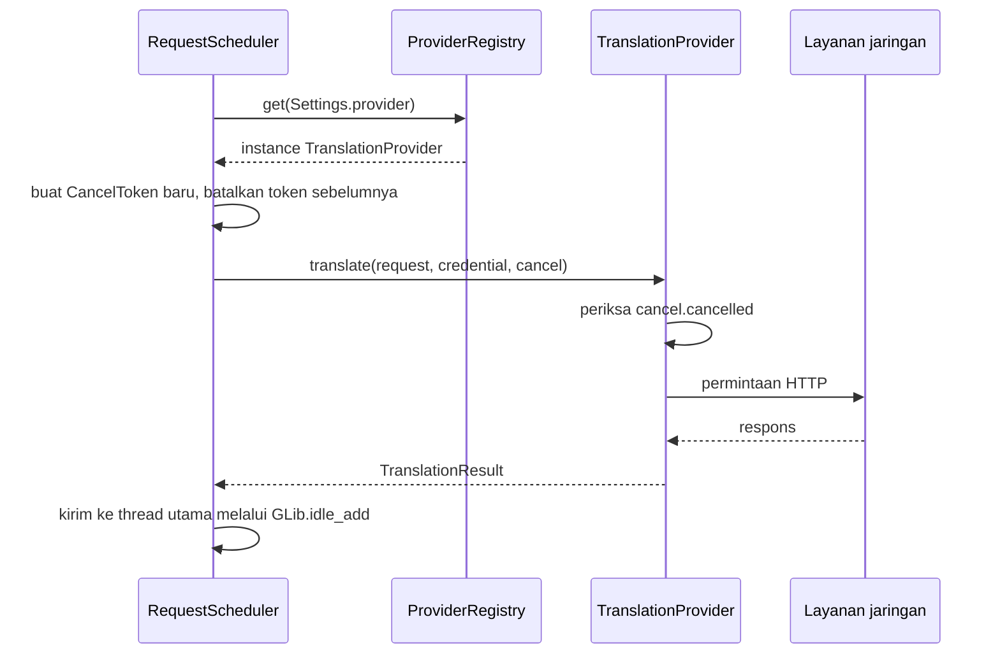

# TranslationProvider

Kontrak yang harus dipenuhi setiap mesin penerjemahan di Pinux. Konsep ini ada agar Pinux dapat memakai layanan terjemahan apa pun — gratis maupun berbasis API key — melalui satu bentuk antarmuka yang seragam, tanpa mengubah kode inti.

## Apa itu TranslationProvider?

TranslationProvider adalah satu komponen yang menerjemahkan Source_Text menjadi hasil terjemahan. Pinux hanya mengetahui kontrak ini, sehingga provider pihak ketiga dapat ditambahkan tanpa menyentuh kode Pinux.

**Ciri utama:**

- Didefinisikan sebagai `Protocol`, bukan kelas dasar, sehingga provider tidak perlu mewarisi kode Pinux.
- Setiap kegagalan wajib dipetakan ke `TranslationError` dengan `kind` yang tepat.
- Menerima `CancelToken` agar pekerjaan jaringan dapat dihentikan ketika ada permintaan lebih baru.

## Lokasi Kode

| Aspek | Lokasi |
|---|---|
| Model dan Protocol | `pinux/translate/base.py` |
| Implementasi Free_Provider | `pinux/translate/google_free.py`, direncanakan pada task 6 |
| Registri provider | `pinux/translate/registry.py`, direncanakan pada task 7 |
| Contoh Keyed_Provider | `examples/deepl_provider.py`, direncanakan pada task 7 |
| Pengujian | `tests/test_models.py` untuk kontrak, `tests/test_translate_google_free.py` untuk impl |

## Bentuk Kontrak

```python
@runtime_checkable
class TranslationProvider(Protocol):
    id: str
    display_name: str

    def requires_credential(self) -> bool: ...
    def list_languages(self) -> Sequence[Language]: ...
    def translate(
        self,
        request: TranslationRequest,
        credential: str | None,
        cancel: CancelToken,
    ) -> TranslationResult: ...
```

### Anggota penting

| Anggota | Tipe | Keterangan |
|---|---|---|
| `id` | `str` | Pengenal unik; dipakai pada `pinux.toml` dan layar pengaturan |
| `display_name` | `str` | Nama tampilan pada layar pengaturan |
| `requires_credential` | `bool` | Menentukan apakah provider tergolong Keyed_Provider |
| `list_languages` | `Sequence[Language]` | Daftar bahasa yang didukung |
| `translate` | `TranslationResult` | Melakukan penerjemahan, atau memunculkan `TranslationError` |

## Klasifikasi Provider

| Jenis | `requires_credential` | Ketersediaan |
|---|---|---|
| Free_Provider | `False` | Selalu tersedia |
| Keyed_Provider | `True` | Tersedia hanya bila Credential sudah tersimpan |

Keyed_Provider tanpa Credential ditampilkan dengan status tidak tersedia pada layar pengaturan, dan tidak dipilih untuk penerjemahan.

## Diagram Alur



## Invarian

Aturan berikut harus selalu berlaku untuk TranslationProvider yang benar:

1. **Galat bertipe.** Setiap kegagalan memunculkan `TranslationError`, bukan pengecualian lain. Nilai `kind` berada pada `ERROR_KINDS`.
2. **Identitas galat.** `TranslationError.provider_id` sama dengan `id` provider yang memunculkannya.
3. **Bahasa terdeteksi terisi.** `TranslationResult.detected_source_lang` selalu berisi kode bahasa, juga ketika `TranslationRequest.source_lang` sudah ditentukan.
4. **Penghormatan pembatalan.** `translate` mengembalikan kendali tidak lama setelah `cancel.cancelled` bernilai benar.
5. **Ketiadaan efek samping berkas.** `translate` tidak menulis berkas pengguna.

## Pemetaan Galat

| Kondisi | `kind` |
|---|---|
| DNS gagal, sambungan ditolak, tidak ada jaringan | `network` |
| Permintaan melampaui `Settings.request_timeout_s` | `timeout` |
| HTTP 401 atau 403 | `auth` |
| HTTP 429 | `rate_limit` |
| HTTP 5xx atau status galat lain | `provider` |
| Ada permintaan lebih baru | `cancelled` |

## Hubungan dengan Konsep Lain

| Konsep | Hubungan |
|---|---|
| [Source_Text](./Source_Text.md) | Menjadi `TranslationRequest.text` |
| [CancelToken](./CancelToken.md) | Diterima `translate` untuk menghentikan pekerjaan yang tidak lagi diperlukan |
| `ProviderRegistry` | Memuat dan memilih TranslationProvider yang aktif |
| `RequestScheduler` | Memanggil `translate` di luar thread utama |
| [OcrEngine](./OcrEngine.md) | Sepadan pada sisi OCR; hasil OCR dapat menjadi Source_Text |
