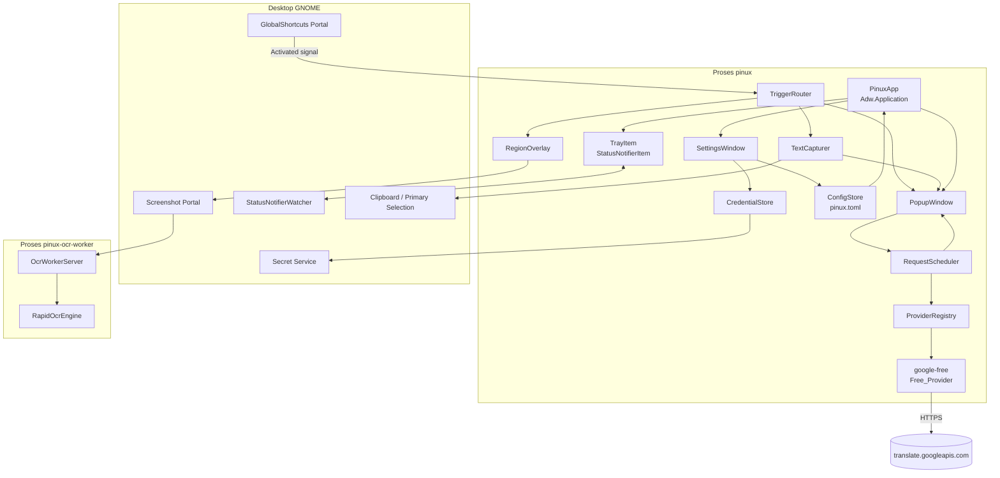
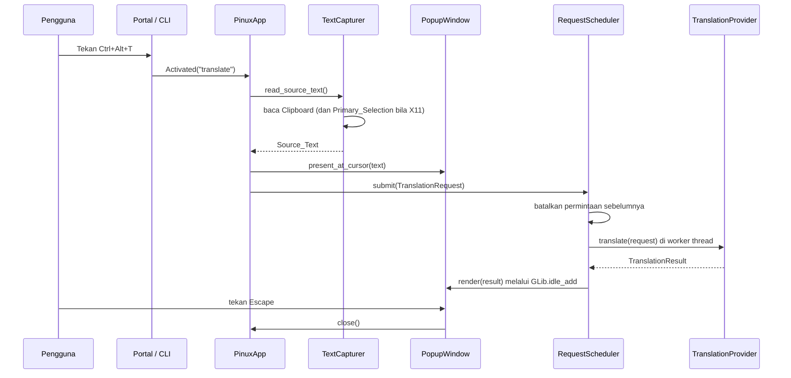
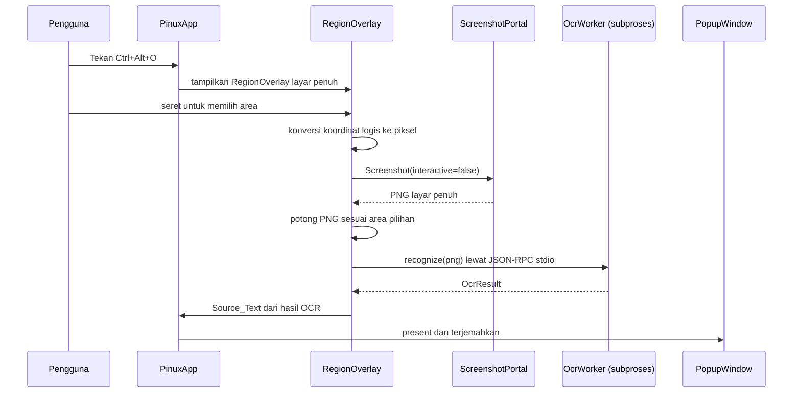

# Pinux — Aplikasi Penerjemah Desktop untuk Linux

Feature Name: 2026-10-16-linux-translator
Updated: 2026-10-16

## Description

Pinux adalah aplikasi penerjemah desktop GTK4/libadwaita untuk Linux yang mengadaptasi alur kerja Bob. Pinux berjalan sebagai layanan latar belakang, mendaftarkan pintasan keyboard global, dan menampilkan jendela popup berisi hasil terjemahan dari teks yang sedang disalin pengguna. Pinux juga menyediakan OCR terjemahan dari tangkapan layar untuk teks yang tidak dapat disorot.

Desain ini menargetkan rilis v1 sebagaimana didefinisikan pada `requirements.md`.

### Keputusan desain utama

| Keputusan | Pilihan | Alasan |
|---|---|---|
| Bahasa dan toolkit | Python 3.11+ dengan PyGObject, GTK 4, libadwaita | Seluruh dependensi sudah tersedia pada sistem target tanpa `sudo`. Integrasi GNOME paling mulus. |
| Model proses | Satu proses GTK4 dengan pekerja latar belakang, ditambah satu proses pekerja OCR yang dijalankan sesuai kebutuhan | Menjaga proses utama tetap ringan dan membebaskan dependensi inti dari ONNX Runtime. |
| Instans tunggal | `GApplication` dengan D-Bus activation | `GApplication` sudah menyediakan pengalihan instans dan penanganan aksi baris perintah tanpa kode tambahan. |
| Pemanggilan global | Portal `GlobalShortcuts`, dengan fallback perintah CLI | Portal tersedia pada GNOME Shell 50, sedangkan fallback menjamin Pinux tetap dapat dipakai pada desktop tanpa portal tersebut. |
| Ikon tray | Implementasi `StatusNotifierItem` murni Python melalui D-Bus | Binding `AyatanaAppIndicator3` tidak tersedia pada sistem target dan pemasangannya memerlukan `sudo`. Protokol SNI diimplementasikan langsung memakai `dbus`/`pydbus` yang tersedia. |
| Penyimpanan kredensial | libsecret melalui typelib `Secret-1` | Nama D-Bus `org.freedesktop.secrets` aktif dan `Secret-1.typelib` tersedia. |
| OCR luring | RapidOCR (ONNX Runtime) pada proses terpisah | Berjalan tanpa jaringan, tidak memerlukan paket sistem, dan wheel `cp314` tersedia untuk onnxruntime maupun rapidocr. |

## Architecture

### Diagram komponen



### Alur pemanggilan terjemahan teks



### Alur OCR terjemahan



### Model konkurensi

Proses utama menjalankan GTK main loop dan tetap non-blokir. Aturan yang berlaku:

1. Semua panggilan jaringan dan OCR dijalankan di luar thread utama.
2. Hasil dari worker dikirim ke thread utama melalui `GLib.idle_add`.
3. Setiap permintaan menerima `CancelToken`. Permintaan baru membatalkan permintaan yang belum selesai.
4. Proses pekerja OCR dijalankan satu kali secara lazy pada OCR pertama dan dihentikan setelah 5 menit tanpa aktivitas.
5. Panggilan D-Bus portal dijalankan pada thread utama dengan timeout, kecuali `Screenshot` yang dijalankan pada worker thread karena portal menampilkan dialog izin.

## Components and Interfaces

### PinuxApp

Komponen akar yang mengelola siklus hidup, aksi aplikasi, dan kepemilikan komponen lain.

```python
class PinuxApp(Adw.Application):
    def __init__(self, config: ConfigStore, ...) -> None: ...

    # Aksi GApplication yang dipetakan ke GApplication.add_main_option
    # --trigger      -> aksi "trigger-translate"
    # --pick-region  -> aksi "trigger-ocr"
    # --settings     -> aksi "settings"

    def do_activate(self) -> None: ...   # instance utama
    def do_startup(self) -> None: ...    # eksekusi satu kali
    def do_shutdown(self) -> None: ...   # lepaskan shortcut, tutup worker
```

Tanggung jawab:
- Menyediakan `Gio.SimpleAction` `trigger-translate`, `trigger-ocr`, `settings`, `quit`.
- Memegang referensi tunggal ke `PopupWindow`, `RegionOverlay`, `SettingsWindow`, dan `TrayItem`.
- Menghentikan proses pekerja OCR dan melepaskan pengikatan shortcut pada shutdown.

### TriggerRouter

Menyatukan seluruh sumber pemicu menjadi satu operasi.

```python
class TriggerRouter:
    def __init__(self, app: PinuxApp) -> None: ...
    def request_translate(self) -> None: ...
    def request_ocr(self) -> None: ...
    def on_shortcut_activated(self, action: str) -> None: ...
```

Sumber pemicu: sinyal `Activated` dari `GlobalShortcutsPortal`, aksi `--trigger` dan `--pick-region` pada instans kedua, menu Tray_Icon, dan tombol pada jendela pengaturan.

### GlobalShortcutsPortal dan ShortcutManager

```python
@dataclass(frozen=True)
class ShortcutSpec:
    id: str                     # "translate" | "ocr"
    description: str
    preferred_trigger: str      # sintaks GTK, misalnya "<Control><Alt>T"

@dataclass(frozen=True)
class BoundShortcut:
    id: str
    trigger: str
    activation_token: str

class GlobalShortcutsPortal:
    def is_available(self) -> bool: ...
    def bind(self, shortcuts: Sequence[ShortcutSpec], parent_window: str) -> list[BoundShortcut]: ...
    def unbind(self, bindings: Sequence[BoundShortcut]) -> None: ...
    def connect_activated(self, callback: Callable[[str], None]) -> None: ...

class ShortcutManager:
    """Memilih portal bila tersedia, dan menyediakan status fallback CLI bila tidak."""
    def start(self) -> ShortcutBackend: ...   # "portal" | "cli"
    def stop(self) -> None: ...
```

Saat backend bernilai `"cli"`, jendela pengaturan menampilkan perintah `pinux --trigger` dan `pinux --pick-region` untuk diikat pengguna pada pintasan keyboard GNOME (R1.3).

`GlobalShortcutsPortal` menangani langkah wajib protokol portal: membuat `session_handle` melalui `CreateSession`, membaca sinyal `Activated` dengan pencocokan `activation_token`, dan menutup sesi pada shutdown.

### TextCapturer

```python
class TextCapturer:
    @property
    def session_type(self) -> Literal["wayland", "x11"]: ...
    def read_source_text(self, *, max_chars: int = 5000) -> CaptureResult: ...
    def connect_changed(self, callback: Callable[[CaptureResult], None]) -> None: ...
    def send_to_clipboard(self, text: str) -> None: ...

@dataclass(frozen=True)
class CaptureResult:
    text: str
    truncated: bool
    origin: Literal["clipboard", "primary", "ocr"]
```

Perilaku menurut `Desktop_Session`:

| Sesi | Sumber teks | Deteksi perubahan |
|---|---|---|
| Wayland | `Gdk.Clipboard` (default display) | Sinyal `changed` pada `GdkClipboard`; isi dibaca saat popup terbuka |
| X11 | `Gdk.Clipboard` dan `Gdk.Display.get_primary_clipboard()`; `Primary_Selection` dipakai bila berbeda | Sinyal `changed` pada kedua objek clipboard |

Catatan Wayland: pembacaan Clipboard hanya dilakukan saat popup terbuka atau saat ada pemicu, sehingga Pinux tidak memantau isi Clipboard secara terus-menerus. Pendekatan ini menghindari kebutuhan izin tambahan dan menjaga privasi.

### RequestScheduler

```python
class CancelToken:
    def cancel(self) -> None: ...
    @property
    def cancelled(self) -> bool: ...

class RequestScheduler:
    def __init__(self, executor: ThreadPoolExecutor, max_workers: int = 4) -> None: ...
    def submit(
        self,
        request: TranslationRequest,
        provider: TranslationProvider,
        credential: str | None,
        on_result: Callable[[TranslationResult], None],
        on_error: Callable[[TranslationError], None],
    ) -> CancelToken: ...
```

- Menyimpan token permintaan aktif. `submit` membatalkan permintaan aktif sebelum menjalankan permintaan baru (R10.4).
- Membungkus `on_result` dan `on_error` dengan `GLib.idle_add`.
- Menetapkan batas waktu 10 detik per permintaan (R10.2).

### TranslationProvider (antarmuka)

```python
@dataclass(frozen=True)
class Language:
    code: str          # kode BCP-47 sederhana, misalnya "id"
    name: str          # nama tampilan, misalnya "Indonesia"

@dataclass(frozen=True)
class TranslationRequest:
    text: str
    source_lang: str | None    # None berarti deteksi otomatis
    target_lang: str

@dataclass(frozen=True)
class TranslationResult:
    text: str
    detected_source_lang: str
    provider_id: str

class TranslationError(Exception):
    kind: Literal["network", "timeout", "auth", "rate_limit", "provider", "cancelled"]
    provider_id: str
    message: str

class TranslationProvider(Protocol):
    id: str
    display_name: str

    def requires_credential(self) -> bool: ...
    def list_languages(self) -> Sequence[Language]: ...
    def translate(
        self,
        request: TranslationRequest,
        credential: str | None,
        cancel: CancelToken,
    ) -> TranslationResult: ...
```

Implementasi `google-free` memakai endpoint publik `translate.googleapis.com/translate_a/single` melalui `urllib.request`, dengan masa tunggu 10 detik dan pembacaan `CancelToken` di antara tahap permintaan.

### ProviderRegistry

```python
class ProviderRegistry:
    def register(self, provider: TranslationProvider) -> None: ...
    def get(self, provider_id: str) -> TranslationProvider | None: ...
    def all(self) -> Sequence[TranslationProvider]: ...
    def load_from_entry_points(self) -> None: ...
```

Sumber pendaftaran, berurutan:

1. Provider bawaan (`google-free`) yang didaftarkan saat startup.
2. Provider dari entri `[[providers]]` pada `pinux.toml`, dengan `module` berupa jalur impor Python. Ini memenuhi R3.3 tanpa mengubah kode inti.
3. Provider dari Python entry point grup `pinux.providers`, untuk distribusi paket mandiri.

### OcrEngine (antarmuka)

```python
@dataclass(frozen=True)
class OcrLine:
    text: str
    confidence: float
    box: tuple[float, float, float, float]

@dataclass(frozen=True)
class OcrResult:
    text: str
    lines: Sequence[OcrLine]

class OcrEngine(Protocol):
    id: str

    def is_available(self) -> bool: ...
    def ensure_model(self, on_progress: Callable[[float], None]) -> None: ...
    def recognize(self, image_png: bytes, cancel: CancelToken) -> OcrResult: ...
```

### OcrWorkerClient

```python
class OcrWorkerClient:
    def is_available(self) -> bool: ...       # impor onnxruntime dan rapidocr berhasil
    def recognize(self, image_png: bytes, cancel: CancelToken) -> OcrResult: ...
    def shutdown(self) -> None: ...
```

Protokol `pinux-ocr-worker`: proses Python terpisah yang berkomunikasi melalui stdin/stdout dengan satu objek JSON per baris.

| Pesan | Arah | Isi |
|---|---|---|
| `{"id": 1, "method": "ensure_model"}` | klien ke worker | memuat atau mengunduh model |
| `{"id": 1, "method": "recognize", "image": "<base64 PNG>"}` | klien ke worker | permintaan pengenalan |
| `{"id": 1, "progress": 0.42}` | worker ke klien | kemajuan unduhan model |
| `{"id": 1, "result": {"text": "...", "lines": []}}` | worker ke klien | hasil |
| `{"id": 1, "error": {"kind": "...", "message": "..."}}` | worker ke klien | galat |

Pembatalan dilakukan dengan mengirim sinyal `SIGTERM` ke proses pekerja dan menjalankan ulang worker pada permintaan berikutnya.

Pemisahan ini memenuhi R7.5: proses utama tidak mengimpor `onnxruntime` maupun `rapidocr`, sehingga Pinux tetap berjalan ketika paket OCR tidak terpasang.

### ScreenshotPortal dan RegionOverlay

```python
class ScreenshotPortal:
    def is_available(self) -> bool: ...
    def capture_fullscreen(self, parent_window: str) -> bytes: ...   # PNG

class RegionOverlay(Gtk.Window):
    def open(self, on_selected: Callable[[Rect], None], on_cancelled: Callable[[], None]) -> None: ...
```

`RegionOverlay` adalah jendela GTK4 tanpa dekorasi yang dimaksimalkan pada monitor tempat kursor berada. Pengguna menyeret untuk memilih area, `Escape` membatalkan (R6.6). Setelah area dipilih, overlay disembunyikan, `ScreenshotPortal.capture_fullscreen` dijalankan, dan citra dipotong secara lokal memakai Pillow memakai koordinat hasil konversi `logical → physical` berdasarkan `Gdk.Surface.get_scale_factor()`.

### PopupWindow

```python
class PopupWindow(Gtk.Window):
    def present_at_cursor(self, x: int, y: int) -> None: ...
    def set_source_text(self, text: str) -> None: ...
    def show_loading(self) -> None: ...
    def show_result(self, result: TranslationResult) -> None: ...
    def show_error(self, message: str) -> None: ...
    @property
    def pinned(self) -> bool: ...
```

Widget: `Gtk.Entry` berisi Source_Text, `Gtk.Label` berisi hasil terjemahan, `Gtk.Spinner` indikator kemajuan, dan tombol salin, tukar bahasa, pin, serta OCR. Jendela dibuat satu kali dan dipakai ulang (R1.5), dengan `Gtk.Window.set_decorated(False)` dan `Gtk.Window.set_resizable(True)`.

Penanganan fokus: sinyal `notify::is-active` menutup jendela ketika jendela kehilangan fokus dan `pinned` bernilai salah (R5.1). Tombol pin mengubah `pinned` (R5.6). Tombol `Escape` dihubungkan ke aksi tutup (R5.2).

### SettingsWindow

Jendela `Adw.PreferencesWindow` dengan halaman:

| Halaman | Isi |
|---|---|
| Umum | Target_Language, bahasa cadangan, perilaku pin bawaan, batas karakter |
| Provider | Daftar Translation_Provider, pemilihan provider aktif, kolom Credential untuk Keyed_Provider |
| Pintasan | Pintasan hasil pengikatan portal, atau perintah CLI yang perlu diikat manual |
| OCR | Status ketersediaan OCR_Engine, tombol unduh model, kemajuan unduhan |

Perubahan pengaturan menulis `pinux.toml` dan langsung diterapkan melalui `GObject.Property` binding tanpa menjalankan ulang Pinux (R9.4).

### ConfigStore

```python
DEFAULT_SETTINGS = Settings(
    target_language="id",
    fallback_language="en",
    provider="google-free",
    max_chars=5000,
    request_timeout_s=10.0,
    shortcuts={"translate": "<Control><Alt>T", "ocr": "<Control><Alt>O"},
    popup={"pin_default": False, "width": 420, "close_on_blur": True},
    ocr={"engine": "rapidocr", "enabled": True},
)

class ConfigStore:
    def load(self) -> Settings: ...
    def save(self, settings: Settings) -> None: ...
    def watch(self, callback: Callable[[Settings], None]) -> None: ...
```

Lokasi berkas: `$XDG_CONFIG_HOME/pinux/pinux.toml` dengan nilai bawaan `~/.config/pinux/pinux.toml`, ditulis secara atomik melalui berkas sementara dan `os.replace`. Pengaturan yang tidak valid memicu pengembalian ke nilai bawaan disertai peringatan berisi nomor baris dari `tomllib.TOMLDecodeError` (R9.5).

### CredentialStore

```python
class CredentialStore:
    def is_available(self) -> bool: ...
    def get(self, provider_id: str) -> str | None: ...
    def set(self, provider_id: str, credential: str) -> None: ...
    def delete(self, provider_id: str) -> None: ...
```

Implementasi utama memakai `gi.repository.Secret` dengan skema `{"provider": provider_id}` dan atribut `pinux-provider`. Bila `Secret-1` tidak tersedia atau Secret Service tidak aktif, `CredentialStore` beralih ke berkas `$XDG_DATA_HOME/pinux/credentials.toml` dengan izin `0600` dan menampilkan peringatan pada jendela pengaturan (R9.3). Kredensial tidak pernah ditulis ke `pinux.toml`.

### TrayItem

```python
class TrayItem:
    def __init__(self, app: PinuxApp) -> None: ...
    def show(self) -> None: ...
    def hide(self) -> None: ...
```

Implementasi `StatusNotifierItem` langsung di atas D-Bus:

| Langkah | Detail |
|---|---|
| Registrasi | Daftarkan nama unik `org.kde.StatusNotifierItem-<pid>-1` dan objek `/StatusNotifierItem` |
| Watcher | Panggil `org.kde.StatusNotifierWatcher.RegisterStatusNotifierItem` |
| Properti | `Category`, `Id`, `Title`, `Status`, `IconName`, `Menu` |
| Menu | Objek `com.canonical.dbusmenu` dengan entri Pengaturan, OCR, dan Keluar |
| Ikon | Nama ikon tema, dengan fallback `IconPixmap` berisi PNG hasil render `Gdk.Texture` |

Bila `org.kde.StatusNotifierWatcher` tidak tersedia pada bus sesi, `TrayItem.show` mengembalikan galat dan `PinuxApp` menampilkan jendela pengaturan (R8.4).

## Data Models

### Settings

```python
@dataclass
class Settings:
    target_language: str = "id"
    fallback_language: str = "en"
    provider: str = "google-free"
    max_chars: int = 5000
    request_timeout_s: float = 10.0
    shortcuts: dict[str, str] = field(default_factory=dict)
    popup: PopupSettings = field(default_factory=PopupSettings)
    ocr: OcrSettings = field(default_factory=OcrSettings)
    providers: list[ProviderEntry] = field(default_factory=list)
```

### pinux.toml

```toml
target_language = "id"
fallback_language = "en"
provider = "google-free"
max_chars = 5000
request_timeout_s = 10.0

[shortcuts]
translate = "<Control><Alt>T"
ocr = "<Control><Alt>O"

[popup]
pin_default = false
width = 420
close_on_blur = true

[ocr]
engine = "rapidocr"
enabled = true

# Provider pihak ketiga didaftarkan di sini.
[[providers]]
id = "deepl"
module = "pinux_provider_deepl:DeepLProvider"
label = "DeepL"
```

### ProviderEntry

```python
@dataclass(frozen=True)
class ProviderEntry:
    id: str          # pengenal unik provider
    module: str      # "package.module:ClassName"
    label: str       # nama tampilan pada layar pengaturan
```

## Correctness Properties

1. **Instans tunggal.** Pada satu waktu, tepat satu proses memegang pengikatan Global_Shortcut. Instans kedua mengalihkan aksinya ke instans pertama melalui D-Bus dan keluar dengan kode 0.
2. **Non-blokir.** Tidak ada operasi jaringan, OCR, atau baca-tulis berkas berskala besar yang dijalankan pada thread utama GTK.
3. **Permintaan terbaru menang.** Untuk setiap penyelesaian permintaan, hasil yang ditampilkan berasal dari permintaan dengan nomor urut tertinggi yang belum dibatalkan.
4. **Tidak ada keadaan memuat yang tersisa.** Untuk setiap permintaan, tepat satu dari `show_result` atau `show_error` dipanggil. Indikator kemajuan berhenti pada kedua jalur.
5. **Source_Text tidak melebihi batas.** Panjang `CaptureResult.text` selalu kurang dari atau sama dengan `max_chars`; `truncated` bernilai benar jika dan hanya jika pemotongan terjadi.
6. **Kredensial tidak bocor.** Berkas `pinux.toml` tidak memuat nilai Credential pada setiap operasi simpan.
7. **Inti bebas dependensi OCR.** Mengimpor `pinux.app`, `pinux.translate`, dan `pinux.config` berhasil tanpa paket `onnxruntime` maupun `rapidocr` terpasang.
8. **Ikonomi tray tidak fatal.** Kegagalan menampilkan Tray_Icon tidak menghentikan proses dan tidak melepaskan Global_Shortcut.
9. **Pemuatan provider terisolasi.** Kegagalan impor satu modul provider dicatat dan diabaikan; provider lain tetap dimuat.
10. **Pengaturan atomik.** Berkas `pinux.toml` hanya berisi konfigurasi lengkap yang valid; penulisan yang gagal tidak merusak berkas sebelumnya.

## Error Handling

| Kondisi | Deteksi | Perilaku |
|---|---|---|
| Jaringan tidak tersedia | `urllib.error.URLError` atau galat DNS | Tampilkan pesan koneksi jaringan tidak tersedia pada Popup_Window (R10.1) |
| Permintaan melewati 10 detik | Batas waktu permintaan | Batalkan permintaan, tampilkan pesan batas waktu (R10.2) |
| Provider mengembalikan status HTTP galat | Kode status HTTP | Bungkus sebagai `TranslationError` dengan `kind` yang sesuai, tulis nama provider dan pesan ke `stderr` (R10.3) |
| Batas laju tercapai | Kode status 429 | Tampilkan pesan batas laju beserta saran menunggu |
| Portal GlobalShortcuts tidak tersedia | Nama D-Bus tidak memiliki pemilik atau `CreateSession` gagal | Beralih ke `ShortcutManager` mode CLI, tampilkan perintah manual pada halaman Pintasan |
| Pengikatan shortcut ditolak pengguna | Sinyal `Response` bernilai negatif | Catat pada `stderr`, jaga Pinux tetap berjalan dengan mode CLI |
| Portal Screenshot tidak tersedia | Nama D-Bus tidak memiliki pemilik | Nonaktifkan aksi OCR dan tampilkan status pada halaman OCR (R6.5) |
| Tangkapan layar ditolak pengguna | Sinyal `Response` bernilai negatif | Tutup Region_Overlay tanpa pesan galat |
| Model OCR belum tersedia | `rapidocr` melaporkan model tidak ditemukan | Unduh model, tampilkan kemajuan unduhan pada halaman OCR (R7.4) |
| Proses pekerja OCR gagal | Keluar dengan kode bukan nol atau aliran terputus | Tampilkan pesan galat OCR, jalankan ulang worker pada permintaan berikutnya |
| Secret Service tidak tersedia | Nama `org.freedesktop.secrets` tidak memiliki pemilik | Beralih ke berkas 0600 dan tampilkan peringatan (R9.3) |
| `pinux.toml` tidak valid | `tomllib.TOMLDecodeError` | Pakai nilai bawaan, tampilkan peringatan berisi nomor baris (R9.5) |
| StatusNotifierWatcher tidak tersedia | Nama D-Bus tidak memiliki pemilik | Lewati tray, tampilkan jendela pengaturan, pertahankan Global_Shortcut (R8.4) |
| Clipboard kosong | Isi clipboard nol panjang | Tampilkan Popup_Window dengan Source_Text kosong dan status siap menerima masukan |

## Risks and Spikes

Bagian ini mencatat risiko teknis yang harus diselesaikan sebelum atau selama implementasi.

1. **Tangkapan area pada Wayland.** Portal Screenshot tidak menyediakan parameter area persegi. Desain memakai strategi tangkap layar penuh lalu potong secara lokal. Spike: pastikan `Screenshot` dengan `interactive=false` mengembalikan citra tanpa menampilkan antarmuka pemilihan pada GNOME Shell 50, dan pastikan cakupan citra meliputi seluruh monitor. Bila tidak, rencana cadangan adalah memakai portal `ScreenCast` dengan PipeWire untuk memperoleh satu bingkai.
2. **Konversi koordinat pada penskalaan fraksional.** Overlay bekerja pada koordinat logis, sedangkan citra hasil tangkapan berada pada koordinat piksel. Spike: uji pada penskalaan 100%, 125%, dan 200% serta pada susunan dua monitor.
3. **Pembacaan Clipboard tanpa fokus pada Wayland.** Uji apakah `GdkClipboard.read_text_async` berhasil ketika jendela Pinux tidak memegang fokus. Bila gagal, rencana cadangan adalah memakai portal `Clipboard` yang tersedia pada sistem target.
4. **Pengikatan GlobalShortcuts portal.** Portal memerlukan interaksi pengguna untuk menyetujui pintasan dan pengikatan tidak bertahan antar sesi. Spike: pastikan Pinux menangani pengikatan ulang pada setiap startup tanpa mengganggu pengguna.
5. **Ketersediaan `cp314` untuk tumpukan ONNX.** Wheel telah diverifikasi ada di PyPI, namun pemasangan aktual pada Python 3.14 belum diuji. Spike: pasang `rapidocr-onnxruntime` dan `onnxruntime` pada virtualenv dan jalankan satu pengenalan gambar.
6. **Struktur paket pihak ketiga.** `StatusNotifierItem` dan `com.canonical.dbusmenu` diimplementasikan manual. Spike: verifikasi tampil pada GNOME Shell 50 dengan ekstensi `appindicatorsupport`.

## Test Strategy

### Pengujian unit dengan pytest

| Modul | Cakupan | Pendekatan |
|---|---|---|
| `pinux.config` | Pemuatan nilai bawaan, penulisan atomik, penolakan TOML tidak valid, pelaporan nomor baris | Uji tabel dengan berkas sementara |
| `pinux.translate.google_free` | Penyusunan URL, penguraian respons, pemetaan galat HTTP ke `TranslationError` | `unittest.mock.patch` pada `urllib.request.urlopen` |
| `pinux.translate.registry` | Pendaftaran provider, kegagalan impor modul yang terisolasi, pemilihan provider | Modul provider palsu pada `tmp_path` |
| `pinux.scheduler` | Pembatalan permintaan sebelumnya, batas waktu, urutan penyelesaian | `CancelToken` palsu dan clock yang dikendalikan |
| `pinux.capture` | Pemotongan pada `max_chars`, penandaan `truncated`, pemilihan sumber teks menurut sesi | Abstraksi clipboard palsu |
| `pinux.ocr.protocol` | Pengodean dan penguraian pesan JSON-RPC, penanganan galat worker | Worker palsu berbasis `subprocess.Popen` |
| `pinux.credentials` | Pemilihan backend, izin berkas 0600, ketiadaan kredensial pada `pinux.toml` | `Secret` palsu dan berkas sementara |

Uji unit tidak memerlukan sesi grafis; modul GTK diuji melalui lapisan tipis yang dapat diganti.

### Pengujian integrasi

Dijalankan pada sesi GNOME milik pengembang, menandai hasil sebagai lulus, gagal, atau dilewati bila portal tidak tersedia:

1. Pengikatan dan pelepasan GlobalShortcut melalui portal.
2. Tangkapan layar penuh melalui `Screenshot` dan pemotongan area.
3. Pendaftaran `StatusNotifierItem` dan pemanggilan entri menu.
4. Pengambilan dan penyimpanan Credential melalui Secret Service.
5. Siklus penuh OCR: overlay, tangkapan, pekerja OCR, popup.

### Matriks pengujian manual

| Skenario | Wayland GNOME | X11 |
|---|---|---|
| Pintasan global memunculkan popup | Wajib | Wajib |
| Teks tersalin otomatis terisi | Wajib | Wajib |
| `Primary_Selection` terisi otomatis | Tidak berlaku | Wajib |
| Perubahan Clipboard memperbarui popup | Wajib | Wajib |
| Escape dan kehilangan fokus menutup popup | Wajib | Wajib |
| Pin menahan popup | Wajib | Wajib |
| OCR area tunggal | Wajib | Wajib |
| OCR pada penskalaan 200% | Wajib | Wajib |
| OCR pada susunan dua monitor | Wajib | Wajib |
| Nonaktif tanpa OCR terpasang | Wajib | Wajib |
| Fallback CLI ketika portal tidak ada | Wajib | Wajib |

### Kriteria penerimaan rilis

Rilis v1 dinyatakan siap ketika:

1. Seluruh uji unit lulus.
2. Seluruh baris matriks pengujian manual berstatus lulus pada sesi Wayland GNOME.
3. Setiap Acceptance Criterion pada `requirements.md` dipetakan ke sekurang-kurangnya satu uji otomatis atau satu baris matriks manual.
4. Pinux berjalan tanpa `sudo` dan tanpa paket sistem tambahan di luar GTK4, libadwaita, dan PyGObject (R11.5).

## References

[^1]: (Website) - [Bob, aplikasi penerjemah macOS yang menjadi acuan alur kerja](https://github.com/ripperhe/Bob)
[^2]: (Website) - [pot-desktop, aplikasi penerjemahan lintas platform berbasis Tauri](https://github.com/pot-app/pot-desktop)
[^3]: (Website) - [Manggo, aplikasi penerjemahan karya penulis pot-desktop](https://manggo.pylogmon.cn/)
[^4]: (Spec) - [Requirements Document Pinux](requirements.md)
