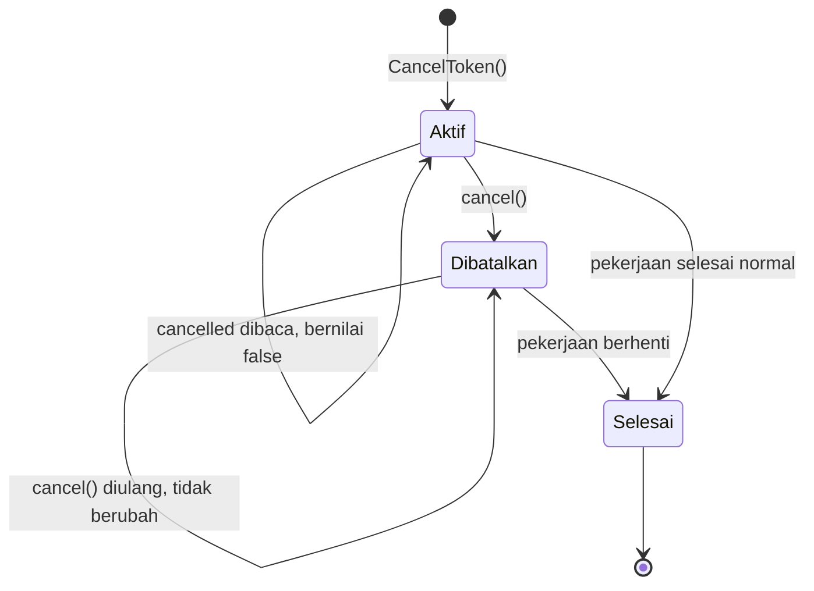

# CancelToken

Mekanisme Pinux untuk menandai bahwa suatu permintaan sudah tidak diperlukan lagi. Konsep ini ada karena pengguna dapat mengetik atau memicu terjemahan berulang kali dengan cepat, sehingga hasil permintaan lama tidak boleh menimpa hasil permintaan terbaru.

## Apa itu CancelToken?

CancelToken adalah penanda pembatalan yang aman dipakai lintas thread. Thread utama memanggil `cancel` ketika ada permintaan baru, sedangkan worker thread membaca `cancelled` di antara tahap pekerjaannya untuk berhenti lebih awal.

**Ciri utama:**

- Aman dipakai lintas thread tanpa kunci tambahan.
- Idempoten: pemanggilan `cancel` berulang tidak mengubah keadaan.
- Bersifat kooperatif: token hanya menandai, sehingga pihak yang menjalankan pekerjaan yang wajib memeriksanya.

## Lokasi Kode

| Aspek | Lokasi |
|---|---|
| Implementasi | `pinux/scheduler.py` |
| Pengujian | `tests/test_models.py` |
| Pemakai | Translation_Provider, OcrEngine, dan penjadwal permintaan |

## Struktur

```python
class CancelToken:
    def cancel(self) -> None: ...
    @property
    def cancelled(self) -> bool: ...
```

### Bidang penting

| Anggota | Tipe | Keterangan |
|---|---|---|
| `cancel` | `None` | Menandai permintaan sebagai dibatalkan; dipanggil dari thread utama |
| `cancelled` | `bool` | `True` bila permintaan sudah dibatalkan; dibaca dari worker thread |

## Diagram Alur



## Penggunaan

```python
# Thread utama: batalkan permintaan sebelumnya sebelum mengajukan yang baru
previous.cancel()
token = CancelToken()

# Worker thread: periksa di antara tahap pekerjaan
if cancel.cancelled:
    raise TranslationError("cancelled", self.id, "Permintaan dibatalkan")
```

## Invarian

1. **Keadaan awal.** Token baru selalu bernilai `cancelled` `False`.
2. **Idempotensi.** `cancel` dapat dipanggil berkali-kali tanpa mengubah hasil.
3. **Monotonisitas.** Setelah bernilai `True`, `cancelled` tidak pernah kembali `False`.
4. **Keamanan thread.** Pembacaan dan penulisan dari thread berbeda tidak menimbulkan balapan data.

## Batasan: pembatalan hanya kooperatif

`CancelToken` **tidak pernah memutus I/O yang sedang berjalan**. `cancel()` hanya
menyalakan `threading.Event`; jalur yang menjalankan pekerjaan wajib memeriksanya
sendiri. Karena itu latensi pembatalan bergantung pada titik pemeriksaan di tiap jalur:

| Jalur | Perilaku saat `cancel()` |
|---|---|
| `OcrWorkerClient` (`pinux/ocr/client.py`) | Memantau tiap 50 ms dan mematikan subprocess pekerja — I/O benar-benar berhenti |
| `RapidOcrEngine` (`pinux/ocr/rapid.py`) | Diperiksa di antara tahap; model lokal berjalan sampai tahap berjalan selesai |
| `_http.post_json` (DeepL, LibreTranslate) | Diperiksa sebelum dan sesudah `urlopen`; `read()` yang sedang berjalan tidak diputus |
| `OpenAiCompatibleProvider` | Diperiksa setelah header diterima, sebelum `read()`; bodi respons tidak diputus |
| `GoogleFreeProvider` | Diperiksa sebelum `read()`; bodi respons tidak diputus |
| `FallbackChain` / `CompareProvider` | Diperiksa di antara provider |

Konsekuensi: untuk provider HTTP, latensi pembatalan maksimum kira-kira sebesar
`timeout_s` provider (bawaan `post_json` 15 detik), bukan seketika.

Keterlambatan itu tetap tidak merusak UX karena `RequestScheduler` membuang hasil
permintaan yang sudah usang: `_dispatch_result` hanya memanggil `on_result` bila
`seq` masih aktif dan token belum dibatalkan, sedangkan `_dispatch_error`
menyembunyikan galat berjenis `cancelled`. Jadi pembatalan yang "kalah cepat"
hanya membuang hasil, tidak menimpa terjemahan terbaru.

## Hubungan dengan Konsep Lain

| Konsep | Hubungan |
|---|---|
| [TranslationProvider](./TranslationProvider.md) | Menerima CancelToken pada `translate` |
| [OcrEngine](./OcrEngine.md) | Menerima CancelToken pada `recognize` |
| `RequestScheduler` | Membuat token baru dan membatalkan token sebelumnya untuk setiap permintaan |
