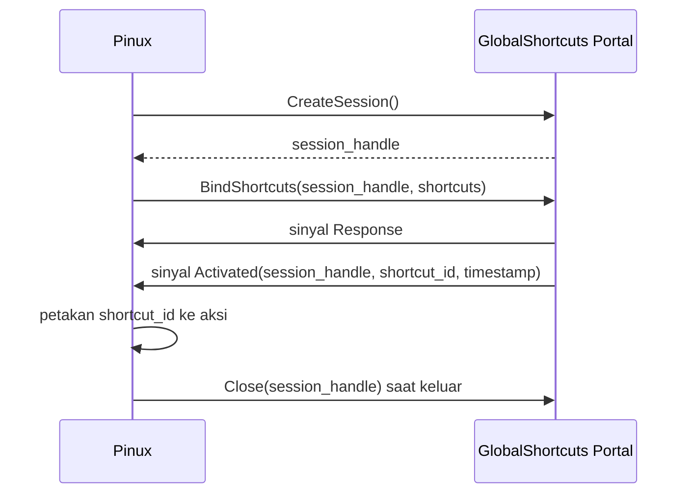

# pinux/portal/

> **Status**: hanya docstring paket yang ada. Seluruh klien portal masih direncanakan.

Paket ini memuat klien portal XDG D-Bus. Portal dipakai alih-alih perkakas baris perintah seperti `gnome-screenshot`, `grim`, atau `xdotool`, karena portal bekerja pada Wayland maupun X11 tanpa paket sistem tambahan.

## Struktur

```
pinux/portal/
└── __init__.py               # Docstring paket
```

Berkas berikut masih direncanakan:

```
pinux/portal/
├── shortcuts.py              # Klien GlobalShortcuts, task 11
└── screenshot.py             # Klien Screenshot, task 12
```

## Klien yang Direncanakan

| Berkas | Antarmuka D-Bus | Kegunaan |
|---|---|---|
| `shortcuts.py` | `org.freedesktop.portal.GlobalShortcuts` | Mendaftarkan dan menerima pemicu pintasan global |
| `screenshot.py` | `org.freedesktop.portal.Screenshot` | Menangkap layar penuh sebelum dipotong |

## Ketersediaan pada Sistem Target

Seluruh portal berikut terverifikasi tersedia pada sistem pengembangan, yaitu GNOME Shell 50.1 dengan backend `org.freedesktop.impl.portal.desktop.gnome`.

`Screenshot`, `GlobalShortcuts`, `RemoteDesktop`, `Clipboard`, `Notification`, dan `Settings` semuanya memiliki antarmuka pada bus sesi. Nama `org.freedesktop.secrets` juga memiliki pemilik, sehingga Secret Service dapat dipakai.

Ketersediaan tersebut tidak menjamin perilaku yang sama pada desktop lain. Setiap klien portal karena itu wajib menyediakan jalur fallback.

## Aturan Implementasi

1. Periksa kepemilikan nama D-Bus tujuan sebelum memanggil, lalu beralih ke jalur fallback bila tidak ada.
2. Tangani sinyal `Response` beserta nilai hasilnya, termasuk penolakan oleh pengguna.
3. Jalankan pemanggilan yang memunculkan dialog izin pada worker thread, bukan thread utama. Untuk `BindShortcuts` gunakan `ShortcutManager.start_async()`; `start()` sinkron memutar loop bersarang pada thread utama (hingga 120 detik) dan hanya untuk pemanggil di luar UI.
4. Tutup sesi portal pada saat Pinux berhenti.

## Sesi Portal GlobalShortcuts

Portal mengharuskan klien membuat sesi sebelum mengikat pintasan.



## Mode Fallback

Ketika portal tidak tersedia atau pengikatan ditolak pengguna, Pinux beralih ke mode perintah baris perintah. Pengguna mengikat sendiri perintah berikut pada pintasan keyboard desktop.

| Perintah | Kegunaan |
|---|---|
| `pinux --trigger` | Memicu terjemahan atas isi Clipboard |
| `pinux --pick-region` | Memicu pemilihan area dan OCR |

Mode ini juga menjadi jalur utama pada desktop yang tidak menyediakan portal GlobalShortcuts.

## Pengujian

| Berkas | Cakupan |
|---|---|
| `tests/test_portal_shortcuts.py` | Rencana pengujian dengan bus palsu, task 11 |
| `tests/test_portal_integration.py` | Rencana pengujian integrasi dengan penanda `skip` bila portal tidak tersedia, task 21.1 sampai 21.2 |
